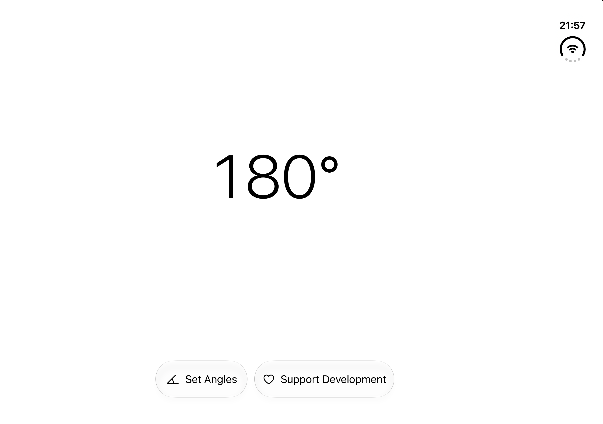

[简体中文](README.md) | [English](README.en.md)

# Duo Angle

Duo Angle is a hinge-angle meter for compatible iPhone Duo devices. It displays the system-provided hinge measurement in an adaptive SwiftUI interface.

## App Store download

[Download DuoAngle – Angle Meter](https://apps.apple.com/us/app/duoangle-angle-meter/id6823964054)

## Main features

- Live hinge-angle readout with an adaptive Duo layout.
- Multiple target angles with enable, edit, and delete controls.
- Haptic feedback when a target angle is reached.
- Optional developer support through StoreKit 2; every app feature remains free.
- Automatic system Light and Dark appearance.

## Screenshot

## Technical architecture

The interface uses SwiftUI and the system hinge measurement API. Target angles are stored locally in `UserDefaults`; optional support purchases use Apple StoreKit 2. The Xcode project is [`DuoAngle/DuoAngle.xcodeproj`](DuoAngle/DuoAngle.xcodeproj).

## Supported languages

Simplified Chinese, Traditional Chinese, English, Japanese, and Korean.

## Device requirements

The deployment target is iOS 27.1. Angle measurement requires compatible hardware that provides system hinge measurements. The iPhone Duo Simulator supports build and UI checks; actual hinge sensing and haptics still require verification on supported hardware.

## Privacy

Read the [English privacy policy](PRIVACY_POLICY_EN.md) or [Chinese privacy policy](PRIVACY_POLICY.md). Target angles stay on the device. The app has no first-party measurement upload service, advertising, or analytics SDK. Apple handles App Store transaction information.

## Developer contact

[hutianchi3622@gmail.com](mailto:hutianchi3622@gmail.com)

## Support the developer

The app offers an optional StoreKit support purchase. All features are available without a purchase. If you would like to make a voluntary WeChat coffee donation, the QR image is in the [Chinese README](README.md#-请作者喝杯咖啡); it does not unlock any app features.

## License and source-code usage

This repository grants no open-source license. All rights remain reserved unless the owner explicitly grants permission.
