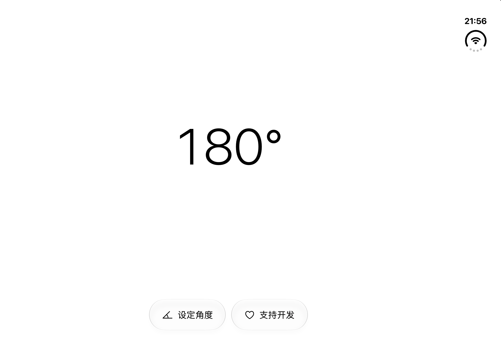

[简体中文](README.md) | [English](README.en.md)

# 有度 / FoldMetry

Duo Angle 是一款面向兼容 iPhone Duo 设备的铰链角度测量应用。它使用系统提供的铰链测量值，通过适配 Duo 布局的 SwiftUI 界面显示当前角度。

## App Store 下载

[下载 DuoAngle – Angle Meter](https://apps.apple.com/us/app/duoangle-angle-meter/id6823964054)

## 主要功能

- 实时显示铰链角度，适配 Duo 显示布局。
- 创建并管理多个目标角度，支持启用、编辑和删除。
- 达到目标角度时提供触觉提醒。
- 通过 StoreKit 2 自愿支持开发者；所有应用功能均可免费使用。
- 跟随系统切换浅色和深色外观。

## 截图

## 技术架构

项目使用 SwiftUI 构建界面，调用系统铰链测量 API；目标角度保存在设备本地 `UserDefaults`，自愿支持购买由 Apple StoreKit 2 处理。Xcode 工程位于 [`DuoAngle/DuoAngle.xcodeproj`](DuoAngle/DuoAngle.xcodeproj)。

## 支持的语言

简体中文、繁体中文、英语、日语和韩语。

## 设备要求

最低系统版本为 iOS 27.1，角度测量需要提供系统铰链测量值的兼容设备。iPhone Duo 模拟器可用于构建与界面检查；真实铰链测量和触觉反馈仍需在受支持的实体设备上验证。

## 隐私

请阅读[中文隐私政策](PRIVACY_POLICY.md)或[英文隐私政策](PRIVACY_POLICY_EN.md)。目标角度存储在本机；应用没有自有测量数据上传服务、广告或分析 SDK。App Store 交易信息由 Apple 处理。

## 联系开发者

[hutianchi3622@gmail.com](mailto:hutianchi3622@gmail.com)

## 支持开发者

应用内提供可选的 StoreKit 支持购买，所有功能均可免费使用。

## ☕ 请作者喝杯咖啡

如果 Duo Angle 对你有所帮助，欢迎请作者喝杯咖啡！你的支持是我继续维护和改进这个小工具的动力。完全自愿，不影响任何功能的使用。

## 许可证与源码使用

本仓库未授予开源许可证。除非所有者另行明确授权，源码权利均予保留。
